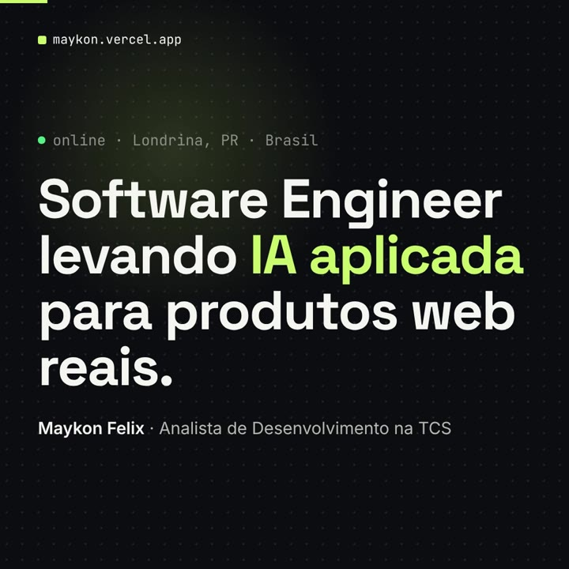

<div align="center">



# Maykon Felix · Portfólio

**Software Engineer levando IA aplicada para produtos web reais.**

[](https://maykon.xyz)
[](https://www.linkedin.com/in/maykonfelixwebdeveloper)
[](https://github.com/MaykonFelix)


</div>

---

## Sobre

Sou **Maykon Felix**, Analista de Desenvolvimento na **Tata Consultancy Services**, em Londrina (PR). Trabalho com **LLMs, RAG e agentes inteligentes** sobre uma base de Next.js, Node.js, Docker e cloud (AWS e Azure).

Este repositório é o meu portfólio: uma página única que mostra como a IA entra em um produto, do dado ao deploy.

## Destaques

| | |
|---|---|
| 🤖 **Agente sobre o currículo** | Um chat que simula um pipeline de RAG: busca trechos, ranqueia e responde mostrando as fontes. |
| 🎬 **Vídeo de apresentação** | Um tour de 30 segundos feito em HTML e renderizado como vídeo com HyperFrames. |
| 🌗 **Tema claro e escuro** | O escuro é o padrão, e a escolha fica salva no navegador. |
| 🌎 **Três idiomas** | Português, inglês e espanhol, detectados pelo idioma do navegador. |
| ✨ **Animações** | Entradas suaves com Motion e barra de progresso de rolagem. |
| 🧩 **Projetos com detalhes** | Cada projeto abre uma janela com descrição e imagens. |

## Seções

```
Hero  →  Como uso IA  →  Stack  →  Trajetória  →  Vídeo  →  Projetos  →  Contato
```

## Stack

- **Framework:** Next.js 16 (App Router) e React 19
- **Linguagem:** TypeScript
- **Estilo:** Tailwind CSS 4 e shadcn/ui (sobre Base UI)
- **Animação:** Motion (`motion/react`)
- **Ícones:** lucide-react
- **Tema:** next-themes
- **Deploy:** Vercel, a cada push no `main`

## Rodando localmente

Precisa de **Node.js 24**. O app fica na subpasta `Portifolio/`.

```bash
git clone https://github.com/MaykonFelix/Portifolio.git
cd Portifolio/Portifolio
npm install
npm run dev
```

Depois abra http://localhost:3000.

| Comando | O que faz |
|---|---|
| `npm run dev` | Servidor de desenvolvimento |
| `npm run build` | Build de produção (inclui checagem de tipos) |
| `npm run start` | Serve o build de produção |
| `npm run lint` | ESLint |

## Estrutura

```
Portifolio/
├── public/
│   ├── images/           # prints dos projetos e avatar
│   └── videos/           # vídeo de apresentação e poster
└── src/
    ├── app/              # layout, página e estilos globais
    ├── components/       # seções, chat do agente, cabeçalho, cards
    │   └── ui/           # componentes shadcn/ui
    └── lib/
        └── content.ts    # todos os textos em PT / EN / ES
```

Para mudar qualquer texto do site, edite `src/lib/content.ts`. Os três idiomas ficam lado a lado nesse arquivo.

## Contato

Quer colocar IA para trabalhar no seu produto? Me chama no [LinkedIn](https://www.linkedin.com/in/maykonfelixwebdeveloper) ou veja o site em **[maykon.xyz](https://maykon.xyz)**.

<div align="center">

<sub>Construído um tijolinho por dia. #NeverStopLearning</sub>

</div>
